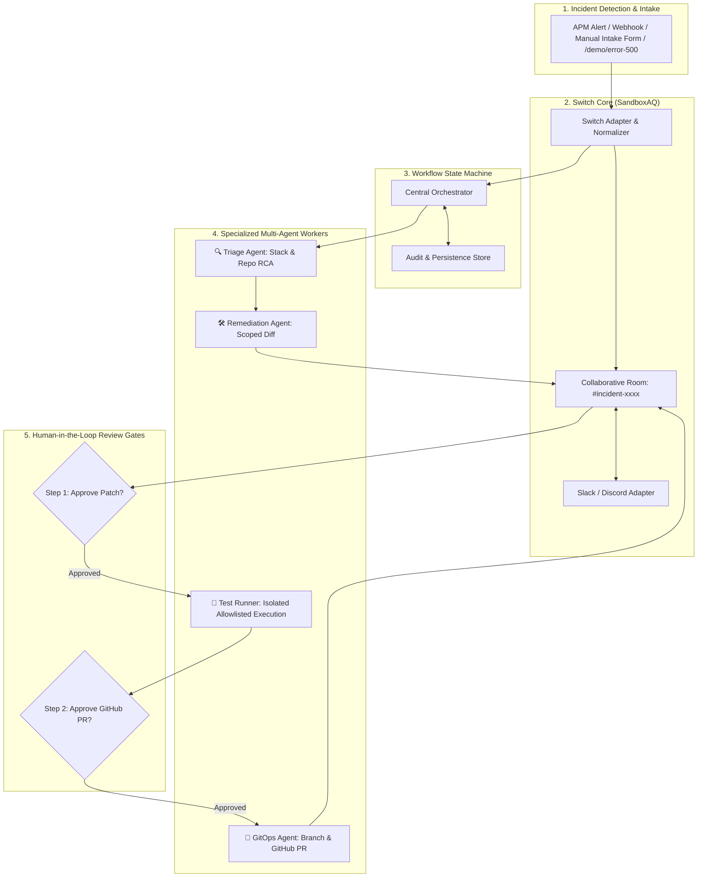

<div align="center">

# ⚡ SwitchOps
### Autonomous Incident Commander & Self-Healing SRE Teammate

**Bridging team chat, specialized AI agents, isolated testing, and GitHub Pull Requests via Switch.**

[](https://www.wemakedevs.org/hackathons/switch)
[-purple)](https://github.com/sandbox-quantum/switch)
[](#)
[](https://www.python.org/)
[-brightgreen.svg)](#-testing)
[](LICENSE)

---

[🚀 Quickstart](#-quickstart) • [📐 Architecture](#-system-architecture) • [🤖 Agent Roles](#-agent-roles--workflow-states) • [🛡️ Security & Safety](#-security-privacy--safety-controls) • [🎥 Demo Script](scripts/demo_recording_script.md)

</div>

---

## 📖 Executive Summary

When application outages occur, engineering teams lose critical time manually correlating alerts across fragmented monitoring dashboards, hunting through repository commits, writing patches under pressure, and synchronizing status across team chat.

**SwitchOps** provides one reliable, evidence-backed workflow:
1. An incident is reported or received through a team collaboration channel (**Slack or Discord**) via **Switch**.
2. The **Triage Agent** investigates the error, retrieves relevant repository files, and returns structured findings citing actual line references.
3. The **Remediation Agent** proposes a strictly scoped patch and presents a readable unified diff.
4. An **Isolated Test Runner** executes allowlisted tests and captures real process output.
5. The **GitOps Agent** creates an incident branch and opens a GitHub Pull Request with complete RCA documentation after human authorization.
6. The entire team receives progress updates, review cards, and the final PR link inside the same Switch room.

> **Transparency Note (Roadmap Section 2 & 16):** All demo incidents, latency timers, and dashboard metrics are labeled as **Simulated demo data**. SwitchOps prioritizes transparent operational measurements over unsupported production claims.

---

## 🔌 What Switch Does & Why It Is Essential

In standard AI developer tooling, agents remain trapped in private local IDEs or terminal windows. 

**[Switch (SandboxAQ)](https://github.com/sandbox-quantum/switch)** solves this context fragmentation:
- **Central Nervous System:** Connects team messaging platforms (Slack, Discord, MS Teams) to agent orchestrators.
- **Shared Room History:** Transforms standard channels into collaborative incident rooms (`#incident-inc-xxxx`), preserving continuous context across human operators and multiple specialized agents.
- **Bi-Directional Event Routing:** Normalizes incoming alerts, deduplicates events with idempotency keys, and dispatches interactive review cards back into the originating room.

---

## 📐 System Architecture



---

## 🤖 Agent Roles & Workflow States

SwitchOps implements the strict multi-step state machine defined in Section 11 of the Roadmap:

| State | Responsible Agent / Actor | Description & Permitted Next States |
| :--- | :--- | :--- |
| `RECEIVED` | Switch Adapter | Incident ingested, normalized, and room bound. ➔ `TRIAGING` |
| `TRIAGING` | **Triage Agent** | Investigates stack trace, searches repo, extracts evidence. ➔ `TRIAGED` |
| `TRIAGED` | Central Orchestrator | Findings generated; invokes remediation. ➔ `AWAITING_FIX_APPROVAL` |
| `AWAITING_FIX_APPROVAL` | **Human Operator** | Reviewer inspects diff in chat/UI. ➔ `PATCH_APPROVED` or `REJECTED` |
| `PATCH_APPROVED` | Central Orchestrator | Patch authorized for testing. ➔ `TESTING` |
| `TESTING` | **Test Runner** | Executes allowlisted tests with resource/time limits. ➔ `TEST_PASSED` / `TEST_FAILED` |
| `TEST_PASSED` | Central Orchestrator | Real exit code 0 captured. ➔ `AWAITING_PR_APPROVAL` |
| `AWAITING_PR_APPROVAL` | **Human Operator** | Reviewer inspects test results and authorizes PR. ➔ `CREATING_PR` or `REJECTED` |
| `CREATING_PR` | **GitOps Agent** | Creates branch, commits patch, and calls GitHub API. ➔ `PR_CREATED` |
| `PR_CREATED` | GitOps Agent | PR link and post-mortem posted to Switch room. (Terminal State) |

---

## 🛡️ Security, Privacy & Safety Controls

1. **Human-in-the-Loop Governance:** Two mandatory review gates (Patch Approval and PR Approval). SwitchOps **never** performs automatic merges or deployments to production.
2. **Path Traversal & Forbidden Files:** Remediation patches are validated against a strict path security policy (`is_safe_path`). Changes to `.env`, `.git`, `.ssh`, or sensitive configuration directories are strictly rejected.
3. **Secret Redaction:** Incoming error traces, logs, and audit payloads pass through an automatic redaction filter (`redact_secrets`) stripping GitHub PATs, Slack tokens, AWS keys, and Bearer tokens.
4. **Command Allowlist:** The Test Runner only allows pre-approved test binaries (`python -m unittest`, `pytest`). Arbitrary model-generated shell commands are blocked.
5. **Idempotency Keys:** Duplicate monitoring events are recognized by fingerprint and discarded to avoid duplicate incident rooms.

---

## 🚀 Quickstart

### Prerequisites
- Python 3.10+ (tested on Python 3.11, 3.12, 3.13)
- Git

### 1. Clone & Install
```bash
git clone https://github.com/YOUR_USERNAME/SwitchOps.git
cd SwitchOps
pip install -r requirements.txt
```

### 2. Configure Environment (Optional)
Copy `.env.example` to `.env`:
```bash
cp .env.example .env
```
Key configuration parameters:
- `SWITCH_GATEWAY_URL`: URL of the Switch Core server (default: `http://localhost:8000`).
- `GITHUB_TOKEN`: Scoped personal access token or GitHub App token (if omitted, SwitchOps runs in local verified PR test mode).
- `GITHUB_REPOSITORY`: Target repository (e.g. `your-org/payments-service`).

### 3. Run the 10-Step Terminal Demo
Run the complete, reproducible 10-step incident workflow right inside your terminal:
```bash
python scripts/run_demo.py
```

### 4. Launch the Web Cockpit UI
Start the interactive dashboard on `http://localhost:5000`:
```bash
python -m switchops.web.app
```
- Open [http://localhost:5000](http://localhost:5000) in your browser.
- Click **🚨 Trigger Demo 500** to simulate a live incident or use **📝 Manual Intake**.
- Click **✅ Authorize Tests** to watch the real test runner execute.
- Click **🚀 Create GitHub PR** to generate the branch and Pull Request.

---

## 🧪 Testing

The repository includes a comprehensive unit and integration test suite implementing the Section 17 testing roadmap:

```bash
python -m unittest discover tests
```

**Test Coverage:**
- Security credential redaction (`test_secret_redaction`)
- Path traversal & forbidden file checks (`test_path_traversal_and_forbidden_paths`)
- Command allowlist verification (`test_command_allowlist`)
- Valid and invalid workflow state transitions (`test_valid_state_transitions`, `test_invalid_state_transitions_raise_error`)
- Incident deduplication via event fingerprints (`test_duplicate_event_handling`)
- Evidence-based root-cause analysis (`test_evidence_based_triage`)
- Real process execution in the isolated test runner (`test_run_real_unit_test`)
- Full end-to-end multi-agent acceptance test (`test_full_incident_remediation_lifecycle`)

---

## 📂 Project Structure

```
SwitchOps/
├── .env.example                       # Environment configuration template
├── README.md                          # Documentation & architecture guide
├── LICENSE                            # Apache 2.0 license
├── pyproject.toml                     # Modern package manifest
├── requirements.txt                   # Dependencies
│
├── switchops/                         # Core Python Package
│   ├── cli.py                         # CLI entry point
│   ├── config.py                      # Configuration loader
│   │
│   ├── core/                          # Incident, Remediation & Safety Engines
│   │   ├── incident_engine.py         # Evidence-based triage & deduplication
│   │   ├── remediation_engine.py      # Narrow patch synthesis & path validation
│   │   ├── test_runner.py             # Isolated execution of allowlisted tests
│   │   ├── git_commander.py           # Git branch, commit & GitHub PR dispatch
│   │   ├── security.py                # Secret redaction & path traversal protection
│   │   ├── workflow.py                # State machine & core entities (Section 8 & 11)
│   │   └── roi_telemetry.py           # Transparent operational measurements
│   │
│   ├── switch_bridge/                 # SandboxAQ Switch Gateway Integration
│   │   ├── adapter.py                 # Dedicated Switch adapter & event normalizer
│   │   ├── client.py                  # Switch core REST client
│   │   ├── room_manager.py            # Central orchestrator & state manager
│   │   └── platform_adapters.py       # Slack & Discord card formatters
│   │
│   ├── sample_apps/                   # Realistic Target Microservices
│   │   └── payments_service/          # Checkout service with currency conversion bug & tests
│   │
│   └── web/                           # REST API & Web Dashboard
│       ├── app.py                     # Flask server with Section 14 REST API
│       ├── templates/index.html       # SRE Cockpit UI
│       └── static/                    # Dark mode styles & live client JS
│
├── scripts/
│   ├── run_demo.py                    # 10-step interactive CLI demo (Section 18)
│   ├── trigger_incident.py            # APM webhook simulator
│   └── demo_recording_script.md       # 3–5 min video recording script with timestamps
│
└── tests/
    └── test_switchops.py              # Section 17 Unit, integration & E2E acceptance tests
```

---

## 🏆 Hackathon Compliance & Submission Checklist

- [x] **Switch Integration Central:** Real Switch adapter validating, normalizing, and deduplicating events with health checks.
- [x] **Evidence-Based Triage:** Cites actual repository files and line numbers; explicitly states uncertainty and confidence level.
- [x] **Safe Scoped Remediation:** Strictly checks allowed paths; never modifies default branch directly.
- [x] **Real Test Runner:** Executes allowlisted test suites, capturing real stdout, stderr, exit codes, and durations.
- [x] **Two-Tier Human Review:** Enforces human authorization before testing and before opening a GitHub PR.
- [x] **GitHub PR Workflow:** Dispatches branch and Pull Request with complete root cause documentation and limitations.
- [x] **Transparent Operational Metrics:** All demo analytics are explicitly labeled as `Simulated demo data`.
- [x] **100% Passing Tests:** Verified against unit, integration, and end-to-end acceptance suites.

---

<div align="center">
Built with ⚡ for the <strong>Flip the Switch Hackathon</strong> (WeMakeDevs & DevTools Academy, powered by Switch AI).
</div>
