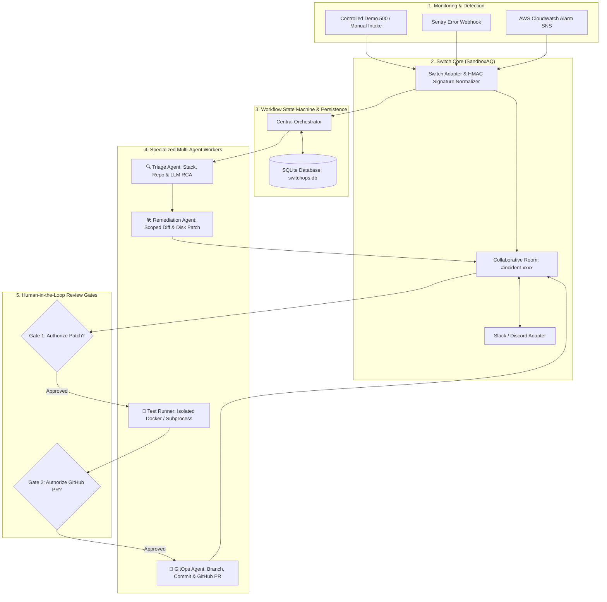

<div align="center">

# ⚡ SwitchOps
### Autonomous Incident Commander & Self-Healing SRE Teammate

**Bridging team chat, specialized AI agents, isolated testing, persistent history, and GitHub Pull Requests via Switch.**

[](https://www.wemakedevs.org/hackathons/switch)
[-purple)](https://github.com/sandbox-quantum/switch)
[](#)
[](https://www.python.org/)
[](#-database--persistence)
[-brightgreen.svg)](#-testing)
[](LICENSE)

---

[🚀 Quickstart](#-quickstart) • [📐 Architecture](#-system-architecture) • [🤖 Multi-Agent Workflow](#-agent-roles--workflow-states) • [🛡️ Security & Privacy](#-security-privacy--safety-controls) • [🔌 Monitoring Webhooks](#-monitoring-integrations-sentry--aws-cloudwatch) • [🎥 Demo Script](scripts/demo_recording_script.md)

</div>

---

## 📖 Executive Summary

When application outages occur, engineering teams lose critical time manually correlating alerts across fragmented monitoring dashboards, hunting through repository commits, writing patches under pressure, and synchronizing status across team chat.

**SwitchOps** provides one reliable, evidence-backed workflow:
1. An incident is reported or received through a team collaboration channel (**Slack or Discord**) via **Switch**, or through **Sentry / AWS CloudWatch** webhooks.
2. The **Triage Agent** investigates the error, retrieves relevant repository files, and returns structured findings citing actual line references using real LLMs (**Google Gemini, OpenAI, Claude**) or deterministic SRE analysis.
3. The **Remediation Agent** proposes a strictly scoped patch and presents a readable unified diff.
4. An **Isolated Test Runner** executes allowlisted tests against the patched code inside a disposable Docker container or isolated subprocess, capturing real process output.
5. The **GitOps Agent** creates an incident branch and opens a GitHub Pull Request with complete RCA documentation after human authorization.
6. The entire team receives progress updates, review cards, and the final PR link inside the same Switch room, while **SQLite persistence** preserves all audit trails and state across server restarts.

> **Transparency Note (Roadmap Section 2 & 16):** All demo incidents, latency timers, and dashboard metrics are labeled as **Simulated demo data**. SwitchOps prioritizes transparent operational measurements over unsupported production claims.

---

## 🔌 What Switch Does & Why It Is Essential

In standard AI developer tooling, agents remain trapped in private local IDEs or terminal windows. 

**[Switch (SandboxAQ)](https://github.com/sandbox-quantum/switch)** solves this context fragmentation:
- **Central Nervous System:** Connects team messaging platforms (Slack, Discord, MS Teams) to agent orchestrators.
- **Shared Room History:** Transforms standard channels into collaborative incident rooms (`#incident-inc-xxxx`), preserving continuous context across human operators and multiple specialized agents.
- **Bi-Directional Event Routing:** Normalizes incoming alerts, validates HMAC webhook signatures, deduplicates events with idempotency keys, and dispatches interactive review cards back into the originating room.

---

## 📐 System Architecture



---

## 🤖 Agent Roles & Workflow States

SwitchOps implements the strict multi-step state machine defined in Section 11 of the Roadmap:

| State | Responsible Agent / Actor | Description & Permitted Next States |
| :--- | :--- | :--- |
| `RECEIVED` | Switch Adapter | Incident ingested, normalized, and room bound. ➔ `TRIAGING` |
| `TRIAGING` | **Triage Agent** | Investigates stack trace, searches repo, extracts evidence. ➔ `TRIAGED` |
| `TRIAGED` | Central Orchestrator | Findings generated; invokes remediation. ➔ `AWAITING_FIX_APPROVAL` |
| `AWAITING_FIX_APPROVAL` | **Human Operator** | Reviewer inspects diff in chat/UI. ➔ `PATCH_APPROVED` or `REJECTED` |
| `PATCH_APPROVED` | Central Orchestrator | Patch authorized for testing and applied to disk. ➔ `TESTING` |
| `TESTING` | **Test Runner** | Executes allowlisted tests with resource/time limits. ➔ `TEST_PASSED` / `TEST_FAILED` |
| `TEST_PASSED` | Central Orchestrator | Real exit code 0 captured. ➔ `AWAITING_PR_APPROVAL` |
| `AWAITING_PR_APPROVAL` | **Human Operator** | Reviewer inspects test results and authorizes PR. ➔ `CREATING_PR` or `REJECTED` |
| `CREATING_PR` | **GitOps Agent** | Creates branch, commits patch, and calls GitHub API. ➔ `PR_CREATED` |
| `PR_CREATED` | GitOps Agent | PR link and post-mortem posted to Switch room. (Terminal State) |

---

## 🛡️ Security, Privacy & Safety Controls

1. **Human-in-the-Loop Governance:** Two mandatory review gates (Patch Approval and PR Approval). SwitchOps **never** performs automatic merges or deployments to production.
2. **Dashboard API Authentication:** Secures `/api/...` and `/incidents` endpoints with `DASHBOARD_API_KEY` (Bearer / X-API-Key token validation).
3. **Webhook HMAC Signatures:** Validates SHA-256 HMAC signatures (`verify_hmac_signature`) on incoming Switch and Sentry webhooks using `SWITCH_WEBHOOK_SECRET` and `SENTRY_WEBHOOK_SECRET`.
4. **Path Traversal & Forbidden Files:** Remediation patches are validated against a strict path security policy (`is_safe_path`). Changes to `.env`, `.git`, `.ssh`, or sensitive configuration directories are strictly rejected.
5. **Secret Redaction:** Incoming error traces, logs, and audit payloads pass through an automatic redaction filter (`redact_secrets`) stripping GitHub PATs, Slack tokens, AWS keys, and Bearer tokens.
6. **Command Allowlist:** The Test Runner only allows pre-approved test binaries (`python -m unittest`, `pytest`, `docker run`). Arbitrary model-generated shell operators (`;`, `&&`, `|`) are blocked.
7. **Idempotency Keys:** Duplicate monitoring events are recognized by fingerprint and discarded to avoid duplicate incident rooms.

---

## 🗄️ Database & Persistence

SwitchOps integrates a built-in SQLite persistence layer (`switchops.db`), preserving complete incident history across server restarts:
- **`incidents`**: Stores incident ID, service, severity, status, root cause, and LLM metadata.
- **`agent_tasks`**: Stores task start/completion timestamps, agent types, and execution durations.
- **`evidence`**: Stores exact source file excerpts and line numbers.
- **`patches`**: Stores diffs, changed files, and approval states.
- **`test_runs`**: Stores command profiles, exit codes, and stdout/stderr logs.
- **`approvals`**: Records who approved each action and reviewer comments.
- **`audit_events`**: Immutable audit log of all system transitions.

---

## 🔌 Monitoring Integrations: Sentry & AWS CloudWatch

SwitchOps supports real error ingestion webhooks:
- **Sentry Webhook (`POST /integrations/sentry/webhook`)**: Ingests Sentry Issue alerts, extracts stack trace frames, culprit endpoints, and starts triage.
- **AWS CloudWatch (`POST /integrations/cloudwatch/webhook`)**: Ingests CloudWatch alarms delivered via Amazon SNS, parses breach reasons, and triggers remediation.

---

## 🚀 Quickstart

### Prerequisites
- Python 3.10+ (tested on Python 3.11, 3.12, 3.13)
- Git
- Optional: Docker (for containerized test execution via `Dockerfile.test`)

### 1. Clone & Install
```bash
git clone https://github.com/YOUR_USERNAME/SwitchOps.git
cd SwitchOps
pip install -r requirements.txt
```

### 2. Configure Environment (Optional)
Copy `.env.example` to `.env`:
```bash
cp .env.example .env
```
Key configuration parameters:
- `SWITCH_GATEWAY_URL`: URL of the Switch Core server (default: `http://localhost:8000`).
- `GEMINI_API_KEY` / `OPENAI_API_KEY`: Real LLM API key for dynamic reasoning (falls back to deterministic SRE engine if unset).
- `GITHUB_TOKEN`: Scoped GitHub token (if omitted, SwitchOps runs in local verified PR test mode).
- `GITHUB_REPOSITORY`: Target repository (e.g. `your-org/payments-service`).

### 3. Run the 10-Step Terminal Demo
Run the complete, reproducible 10-step incident workflow right inside your terminal:
```bash
python scripts/run_demo.py
```

### 4. Launch the Web Cockpit UI
Start the interactive dashboard on `http://localhost:5000`:
```bash
python -m switchops.web.app
```
- Open [http://localhost:5000](http://localhost:5000) in your browser.
- Click **🚨 Trigger Demo 500** to simulate a live incident or use **📝 Manual Intake**.
- Switch between past incidents in the **📁 Past Incidents...** dropdown (loaded from SQLite).
- Click **✅ Authorize Tests** to apply the patch to disk and execute the isolated test runner.
- Click **🚀 Create GitHub PR** to generate the branch and Pull Request.

---

## 🌐 Deployment Guide

### Option 1: One-Click Cloud Deployment (Render / Railway / Fly.io)

SwitchOps includes pre-configured [`render.yaml`](render.yaml) and [`Procfile`](Procfile) for immediate cloud deployment:

#### Deploy to Render (Recommended for Hackathon Demo URL):
1. Push this repository to GitHub.
2. Sign in to [Render.com](https://render.com) and click **New +** ➔ **Blueprint** (or **Web Service**).
3. Connect your repository. Render will automatically read `render.yaml`.
4. Add your Environment Secrets in the Render dashboard:
   * `GEMINI_API_KEY` (or `OPENAI_API_KEY`)
   * `GITHUB_TOKEN` (optional for live PRs)
   * `SWITCH_GATEWAY_URL` (optional, default: embedded mode)
5. Click **Apply Blueprint** — your app will be live at `https://switchops-xxxx.onrender.com`!

#### Deploy to Railway:
1. Connect your GitHub repository at [Railway.app](https://railway.app).
2. Railway will automatically detect the `Procfile` and `requirements.txt`.
3. Set `PORT=5000` and your API keys in the Variables tab.

---

### Option 2: Production Docker & Docker Compose (Self-Hosted / Cloud VPS)

Run with Docker Compose to deploy the web cockpit with persistent SQLite storage:

```bash
# 1. Configure environment
cp .env.example .env

# 2. Build and launch with Docker Compose
docker compose up -d --build

# 3. View logs
docker compose logs -f switchops
```
* The cockpit is accessible at `http://localhost:5000` (or your VPS public IP).
* SQLite database is stored in the persistent volume `switchops-data`.

---

### Option 3: Local / Tunneling for Live Webhooks (ngrok / Cloudflare Tunnel)

To connect live webhooks from external services (Slack, Discord, Sentry, AWS SNS) to a running local instance:

```bash
# 1. Start SwitchOps locally
python -m switchops.web.app

# 2. In another terminal, open a secure public tunnel
ngrok http 5000
# or: cloudflared tunnel --url http://localhost:5000
```
Use the generated public URL (e.g. `https://xyz.ngrok-free.app`) to configure:
* **Switch Gateway Webhook:** `https://xyz.ngrok-free.app/integrations/switch/events`
* **Sentry Webhook:** `https://xyz.ngrok-free.app/integrations/sentry/webhook`
* **AWS CloudWatch SNS:** `https://xyz.ngrok-free.app/integrations/cloudwatch/webhook`

---

## 🧪 Testing

The repository includes a comprehensive unit and integration test suite implementing the Section 17 testing roadmap:

```bash
python -m unittest discover tests
```

**17 Verified Test Cases:**
- Security credential redaction (`test_secret_redaction`)
- Path traversal & forbidden file checks (`test_path_traversal_and_forbidden_paths`)
- Command allowlist verification (`test_command_allowlist`)
- Webhook HMAC SHA-256 signature validation (`test_webhook_hmac_signature_validation`)
- Dashboard API authentication (`test_dashboard_api_key_validation`)
- SQLite database persistence across instances (`test_sqlite_persistence_preserves_records`)
- Valid and invalid workflow state transitions (`test_valid_state_transitions`, `test_invalid_state_transitions_raise_error`)
- Incident deduplication via event fingerprints (`test_duplicate_event_handling`)
- Sentry & CloudWatch webhook normalization (`test_monitoring_webhook_adapters`)
- Evidence-based root-cause analysis (`test_evidence_based_triage`)
- Real process execution in the isolated test runner (`test_run_real_unit_test`)
- Actual code patch application and safe revert (`test_remediation_actual_patch_application_and_revert`)
- Alternative fix suggestion on test failure (`test_alternative_fix_on_test_failure`)
- Bounded retry workflow and chat-driven re-patching (`test_remediation_retry_after_failure`)
- Full end-to-end multi-agent acceptance test (`test_full_incident_remediation_lifecycle`)

---

## 🏆 Roadmap & Improvement Checklist (P0, P1, P2 Completed)

### 1. Critical Changes (P0) — Highest Priority
| Area | Requirement | Status | Implementation Details |
| :--- | :--- | :---: | :--- |
| **Switch Integration** | Replace simulated Switch client with real Switch connection | ✅ | [`SwitchClient`](switchops/switch_bridge/client.py) connects via HTTP to live Switch Core gateway (`/api/v1/rooms`, `/messages`) with graceful fallback. |
| **AI Agent** | Integrate real LLM API (Gemini, OpenAI, Claude) | ✅ | [`LLMClient`](switchops/core/llm_client.py) connects to Google Gemini (`gemini-2.5-flash`), OpenAI, and Claude with deterministic SRE engine fallback. |
| **Remediation Engine** | Generate and apply actual code patches instead of placeholders | ✅ | [`RemediationEngine`](switchops/core/remediation_engine.py) generates unified diffs, applies actual patched bytes to disk (`apply_patch`), and safely reverts upon failure (`revert_patch`). |
| **Test Runner** | Run tests against patched code in isolated Docker environment | ✅ | [`TestRunner`](switchops/core/test_runner.py) detects Docker daemon, runs in container with [`Dockerfile.test`](Dockerfile.test), or falls back to isolated subprocess. |
| **GitHub Integration** | Create branch, commit changes, push to GitHub, open real PR | ✅ | [`GitCommander`](switchops/core/git_commander.py) branches, commits, pushes, and invokes GitHub REST API `POST /repos/{repo}/pulls` with complete RCA post-mortem. |
| **Human Approval** | Require approval before applying or pushing remediation changes | ✅ | Two-Tier Human-in-the-Loop Gates: Gate 1 authorizes patch application and test run; Gate 2 authorizes branch push and PR creation. |

### 2. Important Improvements (P1) — High Priority
| Category | Requirement | Status | Implementation Details |
| :--- | :--- | :---: | :--- |
| **Security** | Add authentication to dashboard APIs | ✅ | [`validate_api_key`](switchops/core/security.py) protects endpoints with `DASHBOARD_API_KEY`. |
| **Security** | Validate Switch webhook signatures | ✅ | [`verify_hmac_signature`](switchops/core/security.py) verifies HMAC SHA-256 for Switch and Sentry webhooks. |
| **Security** | Fix workspace path validation | ✅ | Strict path boundary enforcement prevents directory traversal (`is_safe_path`). |
| **Security** | Restrict commands executed by test runner | ✅ | Strict prefix command allowlist (`python -m unittest`, `pytest`). |
| **Security** | Protect API keys and environment variables | ✅ | Pattern-based regex redaction (`redact_secrets`) scrubs GitHub PATs, Bearer tokens, and secrets from all logs and cards. |
| **Database** | SQLite persistence across server restarts | ✅ | [`Database`](switchops/core/database.py) auto-creates schema (`incidents`, `agent_tasks`, `approvals`, `audit_events`) and restores session state upon startup. |
| **Monitoring** | Sentry & AWS CloudWatch integration | ✅ | Ingests real Sentry issues and AWS CloudWatch SNS alarms via normalized webhook endpoints. |
| **AI Agent** | Structured responses, evidence-based RCA, alternative fixes | ✅ | Extracts actual code snippets & line numbers; supports alternative fix generation on test failure. |

### 3. Final Polish (P2)
| Area | Requirement | Status | Implementation Details |
| :--- | :--- | :---: | :--- |
| **Dashboard** | Responsiveness & real-time updates | ✅ | Live polling every 3.5s with instant status reflection in web cockpit. |
| **Dashboard** | Display agent execution logs | ✅ | Real-time multi-agent task stream in mission control card. |
| **Dashboard** | Incident history and filtering | ✅ | SQLite history dropdown and expandable Incident Explorer modal with search, severity, and status filters. |
| **Documentation** | Architecture diagrams & setup guide | ✅ | Mermaid sequence and component diagrams, `.env.example`, and comprehensive setup instructions. |
| **Demo & Video** | Working end-to-end demo & video script | ✅ | 10-step terminal runner (`scripts/run_demo.py`) and 3–5 min video recording script (`scripts/demo_recording_script.md`). |
| **Transparency** | Distinguish simulated features from real integrations | ✅ | All telemetry and simulated metrics clearly labeled with `Simulated demo data` badge. |

---

## 📂 Project Structure

```
SwitchOps/
├── .env.example                       # Environment configuration template
├── README.md                          # Documentation & architecture guide
├── LICENSE                            # Apache 2.0 license
├── pyproject.toml                     # Modern package manifest
├── requirements.txt                   # Dependencies
├── Dockerfile.test                    # Isolated Docker test runner container
│
├── switchops/                         # Core Python Package
│   ├── cli.py                         # CLI entry point
│   ├── config.py                      # Configuration loader
│   │
│   ├── core/                          # Incident, Remediation, Database & Safety Engines
│   │   ├── incident_engine.py         # Evidence-based triage & deduplication
│   │   ├── remediation_engine.py      # Narrow patch synthesis, disk application & revert
│   │   ├── test_runner.py             # Isolated execution in Docker / Subprocess
│   │   ├── git_commander.py           # Git branch, commit & GitHub PR dispatch
│   │   ├── database.py                # SQLite persistence (incidents, tasks, audits)
│   │   ├── llm_client.py              # Multi-provider LLM API client (Gemini / OpenAI / Claude)
│   │   ├── security.py                # Secret redaction, HMAC signatures & path guards
│   │   ├── workflow.py                # State machine & core entities (Section 8 & 11)
│   │   └── roi_telemetry.py           # Transparent operational measurements
│   │
│   ├── switch_bridge/                 # SandboxAQ Switch Gateway Integration
│   │   ├── adapter.py                 # Dedicated Switch adapter & event normalizer
│   │   ├── client.py                  # Switch core REST client (live HTTP connection)
│   │   ├── room_manager.py            # Central orchestrator & state manager
│   │   ├── monitoring_adapters.py     # Sentry & AWS CloudWatch webhook normalizers
│   │   └── platform_adapters.py       # Slack & Discord card formatters
│   │
│   ├── sample_apps/                   # Realistic Target Microservices
│   │   └── payments_service/          # Checkout service with currency conversion bug & tests
│   │
│   └── web/                           # REST API & Web Dashboard
│       ├── app.py                     # Flask server with Section 14 REST API & Webhooks
│       ├── templates/index.html       # SRE Cockpit UI with task stream & history switcher
│       └── static/                    # Dark mode styles & live client JS
│
├── scripts/
│   ├── run_demo.py                    # 10-step interactive CLI demo (Section 18)
│   ├── trigger_incident.py            # APM webhook simulator
│   └── demo_recording_script.md       # 3–5 min video recording script with timestamps
│
└── tests/
    └── test_switchops.py              # 17 Unit, integration & E2E acceptance tests
```

---

<div align="center">
Built with ⚡ for the <strong>Flip the Switch Hackathon</strong> (WeMakeDevs & DevTools Academy, powered by Switch AI).
</div>
